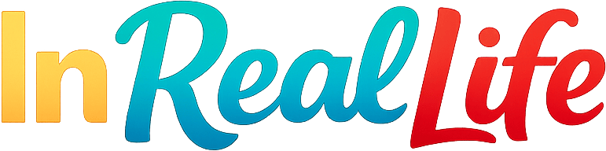

  

## The best social network is real life.

InRealLife gets people off the feed and face to face. See a plan near you, say yes, show up. The best IRL app is one you rarely open.

**Three apps. One account.**

<table>
  <tr>
    <td valign="top" width="33%">
      <b>WORK</b>  
      <a href="https://bondable.inreallife.technology">
        <picture>
          <source media="(prefers-color-scheme: dark)" srcset="https://raw.githubusercontent.com/inreallife-technology/.github/main/profile/logos/bondable-white.png">
          
        </picture>
      </a>
      <h3>Share what you know. Build something together.</h3>
      Professional connections start with something to do.  
      <a href="https://bondable.inreallife.technology"><b>Visit Bondable →</b></a>
    </td>
    <td valign="top" width="33%">
      <b>FRIENDS</b>  
      <a href="https://hangout.inreallife.technology">
        <picture>
          <source media="(prefers-color-scheme: dark)" srcset="https://raw.githubusercontent.com/inreallife-technology/.github/main/profile/logos/hangout-white.png">
          
        </picture>
      </a>
      <h3>Good times, good company.</h3>
      With friends you know and people you haven't met yet.  
      <a href="https://hangout.inreallife.technology"><b>Visit Hangout →</b></a>
    </td>
    <td valign="top" width="33%">
      <b>DATING</b>  
      <a href="https://flirtify.inreallife.technology">
        <picture>
          <source media="(prefers-color-scheme: dark)" srcset="https://raw.githubusercontent.com/inreallife-technology/.github/main/profile/logos/flirtify-white.png">
          
        </picture>
      </a>
      <h3>The activity is the first date.</h3>
      Do something together, and see where it leads.  
      <a href="https://flirtify.inreallife.technology"><b>Visit Flirtify →</b></a>
    </td>
  </tr>
</table>

A ban on one app is a ban on all three. What you do on Flirtify stays on Flirtify.

### What we believe

- If it doesn't get real people together, face to face, it doesn't ship.
- Trust comes first. No metric justifies making people feel unsafe.
- Free to meet. Paid for tools, never for access.
- Show activities, never people. No feed, no likes, no profiles to browse.
- AI prepares, a person decides. No AI makes a decision about a person that can't be undone.
- We count one thing: did people actually meet.

All of it, written down: [inreallife.technology/philosophy](https://inreallife.technology/philosophy)

### Discover

- **[inreallife.technology](https://inreallife.technology)**: find a plan near you and try the apps.
- **[Bring your own AI](https://inreallife.technology/ai)**: find and join plans from Claude, ChatGPT or any MCP client, on Bondable and Hangout.
- **[Developers](https://inreallife.technology/developers)**: the apps use only the public API, the same one anyone can build on. [API docs](https://api.inreallife.technology/docs).

[Instagram](https://www.instagram.com/getinreallife) · [TikTok](https://www.tiktok.com/@getinreallife) · [X](https://x.com/getinreallife) · [YouTube](https://www.youtube.com/@getinreallife) · [LinkedIn](https://www.linkedin.com/company/getinreallife) · [hello@inreallife.technology](mailto:hello@inreallife.technology)
